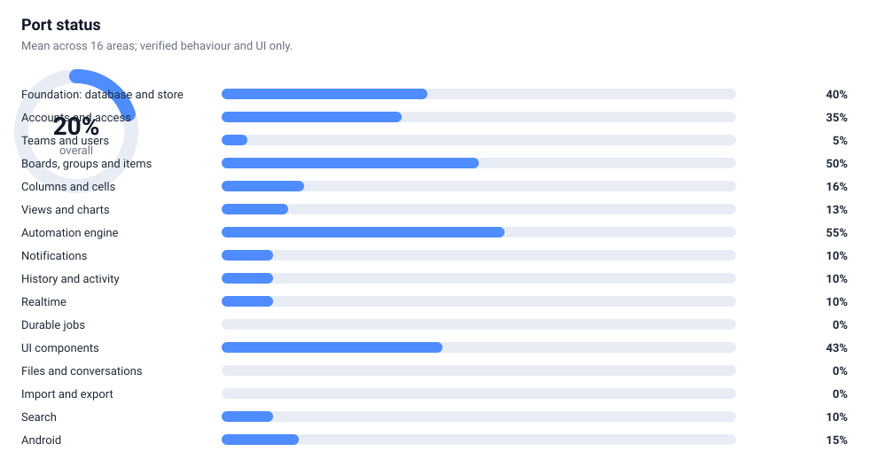

# boardcraft

boardcraft is the native Rust port of the internal tool: its entire C# and React/TSX surface rebuilt in Rust with Longbridge GPUI Kit and PostgreSQL. The whole product is the scope.

**The only job is to get boardcraft running 1:1 with the internal tool, in Rust only. Write Rust code, run it, and test the UI with Computer Use and GPUI Kit tests. No extra harnesses or infrastructure.**

**Parity includes workflow, UI and UX.** Match the result and the experience of reaching it: layout and density, controls and labels, defaults, feedback, keyboard/touch, focus and dismissal, navigation, failure/retry, and preserved selection and drafts. A screen is complete only after comparison in the running apps; tests or screenshots alone do not close it. Remaining differences are recorded in [the workflow register](docs/workflows.md).

Delivery shape: two containers — `boardcraft` on **5078** for every client, and the database private behind it. Documented in [docs/deployment.md](docs/deployment.md); not built yet.

Everything here is our own work: our schema, our rules, our controls, our names and our fixtures. This repository contains no other product's code, assets or wording. See [AGENTS.md](AGENTS.md) for the rule that applies to every change.

<!-- PORT-STATUS:START -->
## Port map

**Overall: 16%** — mean across 16 areas. A handoff names one area; it includes its Rust rules, UI and desktop/browser/Android behaviour. Once the contract is stable, UI and cross-platform work run as two concurrent subagents.

| Area | What it covers | Code home | Ported |
|---|---|---|---|
| [Foundation: database and store](areas/foundation.md) | Schema, migrations, board/group/item persistence, transactions and failure recovery. Everything else depends on these rules being correct and durable. | `crates/board/src/store`, `crates/board/migrations` | 40% |
| [Accounts and access](areas/accounts.md) | Sign-in, sessions, roles, workspace and board visibility, and permissions. A board action is allowed only when the owning rule says so. | `crates/account/src`, `crates/mobile-edit-host/src/access.rs` | 35% |
| [Teams and users](areas/teams.md) | Users, roles, teams and membership: create and manage accounts, assign roles, add people to teams and keep access rules consistent with board permissions. | `crates/account/src/users`, `crates/account/src/teams` | 5% |
| [Boards, groups and items](areas/boards.md) | The board list, groups, items, rename, ordering, selection, move, archive and trash, across desktop, browser and Android. | `crates/board/src`, `crates/desktop/src/connected`, `crates/web/src/groups` | 50% |
| [Columns and cells](areas/columns.md) | Every column type: setup, defaults, validation, editors, display, formulas, linked items and file cells. The same rule serves direct edits, batch writes and imports. | `crates/board/src/columns`, `crates/mobile-edit-host/src/columns.rs`, `crates/mobile-edit-host/src/web_session.rs`, `crates/mobile-edit-client/src/status.rs`, `crates/boardcraft-ui/src`, `crates/desktop/src/connected/main_table/status.rs`, `crates/web/src/groups`, `crates/web/src/session.rs`, `android/src/navigation/status.rs` | 12% |
| [Views and charts](areas/views.md) | Saved views, filters, sorting, grouping, chart settings and forms. Shared and personal settings stay distinct. | `crates/board/src/views`, `crates/web/src/views` | 10% |
| [Automation engine](areas/automation.md) | Triggers, conditions, actions, scheduling and retries. Port the rule engine, its editor UI and its desktop/browser/Android behaviour together. | `crates/board/src/automation`, `crates/desktop/src/automation`, `crates/web/src/automation` | 10% |
| [Notifications](areas/notifications.md) | Inbox, preferences, seen state and email/push delivery. A notification points at the record and action that produced it. | `crates/board/src/notifications.rs`, `crates/mobile-edit-host/src/notifications.rs`, `crates/mobile-edit-client/src/notifications.rs`, `crates/desktop/src/connected/navigation.rs`, `android/src/navigation.rs` | 10% |
| [History and activity](areas/history.md) | Activity log, updates, revisions and undo. History is append-only and survives restart. | `crates/board/src/history`, `crates/mobile-edit-host/src/activity.rs`, `crates/mobile-edit-client/src/activity.rs`, `crates/desktop/src/connected/main_table/activity.rs`, `android/src/navigation/activity.rs` | 10% |
| [Realtime](areas/realtime.md) | Live board refresh and presence: the SignalR equivalent. A second client sees an accepted change without a manual reload. | `crates/mobile-edit-host/src/realtime.rs`, `crates/mobile-edit-client/src/realtime.rs`, `crates/desktop/src/connected/navigation.rs`, `android/src/lib.rs`, `android/src/realtime.rs` | 10% |
| [Durable jobs](areas/jobs.md) | Background scheduling that survives restart: the Hangfire equivalent. Enqueue only after the owning transaction commits, and make retries safe. | `crates/jobs` | 0% |
| [UI components](areas/ui.md) | GPUI Kit controls, layout, theme, dialogs, keyboard and focus. Shared controls live in `boardcraft-ui`; screens own their composition and drafts. | `crates/boardcraft-ui`, `crates/desktop/src`, `crates/web/src`, `android/src` | 43% |
| [Files and conversations](areas/files.md) | Attachments, previews, comments and chat. Files are stored once, previewed safely and reachable from the record they belong to. | `crates/files`, `crates/boardcraft-ui/src/files` | 0% |
| [Import and export](areas/import.md) | Spreadsheet and archive import, mapping, progress, cancellation, retry and publication. Reject bad input without exposing partial results. | `crates/board/src/import`, `crates/desktop/src/import` | 0% |
| [Search](areas/search.md) | Board, workspace and global search. Results respect access and return the record, not just a label. | `crates/board/src/search`, `crates/web/src/board_search.rs` | 10% |
| [Android](areas/android.md) | Native Android parity with the desktop journey: sign-in, sessions, board list, groups, items and recovery on a phone. | `android/src` | 15% |



**How the percentage works.** 0% is not started. 100% means every workflow in that area matches the internal tool on desktop, browser and Android — behaviour and UI, observed in the running app. Count verified user-visible behaviour only, never code, tests or scaffolding. When unsure, lower it. Change an area's `percent` in `areas/<id>.md`; the table and chart regenerate on commit.
<!-- PORT-STATUS:END -->

**First workflow:** Two items on a board are both called “Review”. Rename the second one to “Review artwork”, close the app, then reopen the board. The first row should still say “Review”; the second should keep its new name. The edit targets the item's ID, so matching titles never decide which row changes.

**Available today:** The [board integration test](crates/board/tests/board_edit.rs) verifies the rename in memory. The [PostgreSQL test](crates/board/tests/postgres_board.rs) checks persisted results after reconnecting. The desktop editor's [row-boundary test](crates/desktop/tests/desktop_edit.rs) covers save, failure and retry. The [Windows window test](crates/desktop/tests/windows_smoke.rs) verifies rejection, focus, correction and persistence across app restart. Follow the [development runbook](docs/development.md#windows-inline-edit-acceptance) to reproduce it. The [workflow register](docs/workflows.md) tracks what is verified and what is still open.

Windows and Android are the active targets; iOS follows Android, once Android's checks pass and a Mac is available. Rust owns the rules for board operations, PostgreSQL stores saved board data, and [Longbridge GPUI Kit](https://github.com/longbridge/gpui-kit) supplies the desktop controls.

## Open a board in the browser

From the checkout root on Windows:

```sh
cargo run --locked --manifest-path tools/Cargo.toml -- viewer
```

The Rust viewer builds the GPUI WebAssembly client and opens the board list in your default browser as the local owner. Choose **Review** to try the rename journey, or **Backlog** for an empty board. No username or password is needed. Press Enter in the terminal to stop the host and discard the fixture. See the local UI port checklist in `plan/` (ignored) and [viewer setup](docs/development.md#browser-viewer).

For unattended viewer checks, run `cargo run --locked --manifest-path tools/Cargo.toml -- viewer --for-seconds 180`. Open the printed URL in Chrome. The fixture expires automatically; no terminal input or process cleanup is needed.

## Requirements

Install Rust with Cargo, rustfmt and clippy. Desktop work adds Visual Studio's **Desktop development with C++** workload, the Windows SDK, CMake and a graphical session. PostgreSQL journeys need PostgreSQL 17 and a disposable database of their own. Cargo build scripts and tests run with your account's permissions, so use a checkout and development account that hold no production credentials. A fresh public checkout must build without private material; the [development runbook](docs/development.md) names the tools and environment variables.

## Developer commands

Work directly from the checkout: pick the current delivery step, build it, run it, and report what you saw. The tools binary only prepares, builds and runs:

```sh
cargo run --locked --manifest-path tools/Cargo.toml -- viewer [--for-seconds N]
cargo run --locked --manifest-path tools/Cargo.toml -- dev -- cargo build --locked -p boardcraft-desktop
cargo run --locked --manifest-path tools/Cargo.toml -- postgres start|stop|exec -- PROGRAM [ARG...]
cargo run --locked --manifest-path tools/Cargo.toml -- prepare-web
```

The queue runner and unattended dispatch were removed. Do not rebuild them.

Use Computer Use for live UI observations and GPUI Kit tests for control behavior. The former browser and Android UI drivers are historical; do not rebuild them.

## Where to read next

| Question | Read |
|---|---|
| What do I build next, and what counts as done? | [ROADMAP.md](ROADMAP.md#delivery-order-owner-direction-2026-11-28) and [docs/workflows.md](docs/workflows.md) |
| How do I build, run and recover the environment? | [docs/development.md](docs/development.md) |
| Where does behaviour live? | [docs/architecture.md](docs/architecture.md) |
| What is verified, and what is still unknown? | [docs/workflows.md](docs/workflows.md) |
| Which document do I update for this change? | [docs/README.md](docs/README.md) |
| How must a worker behave? | [AGENTS.md](AGENTS.md) |
